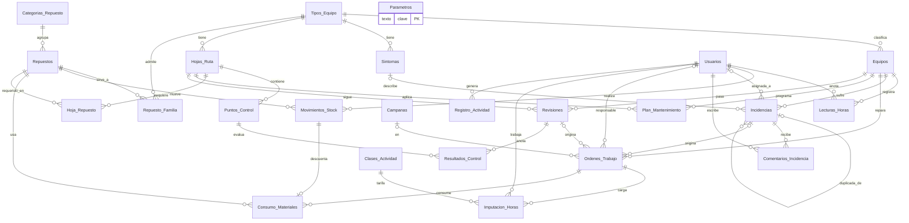

# Modelo de datos

Diagrama entidad-relación de AgroGMAO. El diccionario completo de campos está en el documento 'Modelo de Datos (E/R y diccionario)' del proyecto.

## Estado de implementación

Entidades creadas en el hito H1 (Base):

| Entidad | App | Modelo | Función |
| --- | --- | --- | --- |
| Usuarios | `cuentas` | `Usuario` | US-01 a US-04 |
| Parametros | `explotacion` | `Parametro` | CF-01 | 
| Clases_Actividad | `explotacion` | `ClaseActividad` | CF-02 |
| Tipos_Equipo | `equipos` | `TipoEquipo` | CF-03 |
| Equipos | `equipos` | `Equipo` | EQ-01, EQ-03, EQ-04, EQ-07 |

El resto de entidades del diagrama se crean en los hitos siguientes.